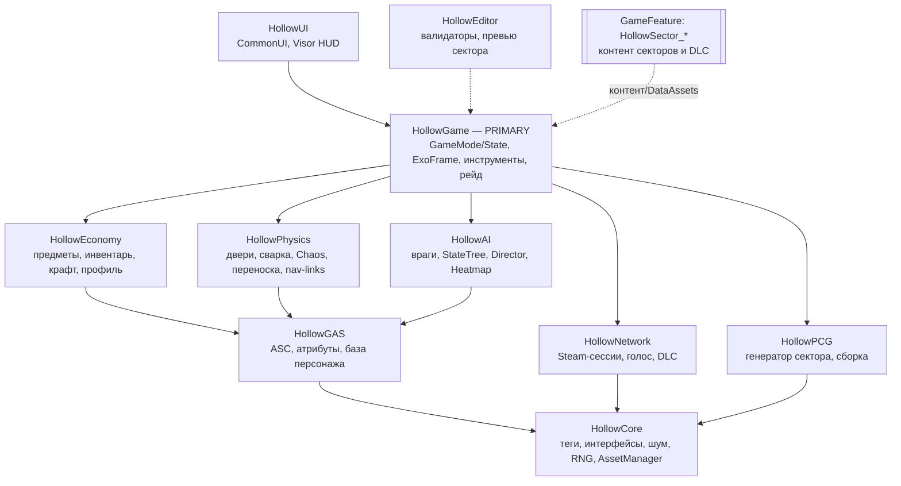

# Блок 1 — High-Level Architecture & карта модулей/плагинов UE5

> Статус: **Proposed v0.1** · 2026-11-19
> Решения, которые расходятся с буквой `CLAUDE.md` или требуют твоего подтверждения, помечены 🔶 и вынесены в `Docs/ADR/`.

---

## 1.1 Версия движка: фиксируем UE 5.8.x 🔶 [ADR-0008](../ADR/ADR-0008-engine-version-lock.md)

В брифе указано «5.4 / 5.5+». На ноябрь 2026 актуальна 5.8 (вышла в июне 2026, есть хотфикс 5.8.1).

| Что известно о 5.8 | Что это значит для Protocol: Hollow |
|---|---|
| Скорее всего, последний релиз ветки UE5 перед UE6 | Самая долгоживущая и вылизанная 5.x. На UE6 до релиза 1.0 не переходим |
| MegaLights → Production Ready | Десятки мерцающих источников с тенями в хорроре становятся реальными. Цену на RTX 3060 меряем в Sprint 4, основа освещения от MegaLights не зависит |
| Lumen Lite (Beta): GI/Reflections на уровне «Medium» через irradiance fields, примерно вдвое дешевле Lumen High | Пресет Low и Steam Deck. Отражения на этом уровне работают через SSR |
| SSGI объявлен deprecated | Запасного GI без Lumen больше нет. Процедурный уровень невозможно запечь, поэтому у нас всегда Lumen (Lite на слабом железе) |
| PCG Framework в статусе Production Ready (с 5.7), runtime-планировщик стал дешевле для game thread | Берём, но в основном на этапе редактора (см. [ADR-0003](../ADR/ADR-0003-sector-manifest-replication.md)) |
| Chaos Caching расширен, есть воспроизведение в рантайме | «Геройские» проломы переборок проигрываем из кэша (Блок 3, §3.4) |

**Правило:** движок обновляем только на хотфиксы 5.8.x. Каждое обновление идёт отдельным коммитом, после него прогоняем `Automation RunTests Hollow` и делаем smoke-тест на двух игроках.

---

## 1.2 Принципы слоёв

1. **Зависимости строго ацикличны и идут снизу вверх.** Нижний модуль ничего не знает о верхних. Связь в обратную сторону идёт только через интерфейсы из `HollowCore`, делегаты, `FGameplayTag` и `TSoftClassPtr` внутри DataAssets.
2. **Модуль = домен, а не тип класса.** Всё про двери (state machine, nav-link, тесты, DataAsset) лежит в одном модуле.
3. **Чистая логика отделена от UObject-обвязки.** Генератор сектора, математика сварки, резолвер экстракции и кривые Резонанса — это plain C++ или функции над USTRUCT. Их можно тестировать без `UWorld`.
4. **Серверные системы** (Director, Heatmap, Economy resolver, Raid flow) живут в `UWorldSubsystem` или в компонентах GameMode и включаются только при `GetNetMode() != NM_Client`. Проверку делаем в `OnWorldBeginPlay`, в `ShouldCreateSubsystem` NetMode ещё не определён. Для Standalone и Listen это один и тот же путь, solo = co-op (CLAUDE.md §1).
5. **Код не предполагает, что на сервере есть локальный игрок.** В геймплее запрещены `GetFirstPlayerController()` и `GetPlayerPawn(0)`. Тогда dedicated-сервер в будущем не потребует переписывания, хотя в v1 его не делаем.

---

## 1.3 Карта модулей


*Стрелка A → B означает «A зависит от B».*

| Модуль | Тип | Ответственность | Зависит от (наши) | Ключевые зависимости движка | Лог-категория |
|---|---|---|---|---|---|
| **HollowCore** | Runtime | Лог-категории, нативные GameplayTags, интерфейсы взаимодействия (§1.4), `UHollowAssetManager`, `UHollowDeveloperSettings`, сетевая квантизация, детерминированный RNG и хеши, `UHollowNoiseSubsystem` (единая точка шума для AI Hearing) | — | Core, CoreUObject, Engine, GameplayTags, DeveloperSettings, NetCore, AIModule *(private, ради `UAISense_Hearing`)* | `LogHollowCore` |
| **HollowGAS** | Runtime | `UHollowAbilitySystemComponent`, AttributeSets, базовые Ability/Effect/Execution, `UHollowAbilitySet`, `AHollowCharacterBase` (общая база игрока и врага: ASC-интерфейс, смерть, теги) | Core | GameplayAbilities, GameplayTasks, GameplayTags | `LogHollowGAS` |
| **HollowEconomy** | Runtime | DataAssets предметов, рецептов и модулей, инвентарь на FastArray, валидация крафта, страховка, `FHollowExtractionResolver`, профиль и SaveGame | Core, GAS | NetCore | `LogHollowEconomy` |
| **HollowNetwork** | Runtime | Steam-сессии, лобби, инвайты, голос (VOIP-talkers и громкость → шум), DLC-entitlements, сетевая диагностика. **Репликация геймплея здесь не живёт**, она остаётся в своих доменах | Core | OnlineSubsystem, OnlineSubsystemUtils, Voice, AudioMixer, Steamworks *(private, для DLC)* | `LogHollowNet` |
| **HollowPhysics** | Runtime | State machines дверей, сварки и резки, Chaos-переборки, переноска ядер, гравитационные зоны, баррикады, бюджет разрушений, nav-links и nav-обновления, `UHollowCharacterMovementComponent` | Core, GAS | PhysicsCore, Chaos, ChaosSolverEngine, GeometryCollectionEngine, FieldSystemEngine, ChaosCaching, NavigationSystem | `LogHollowPhysics` |
| **HollowPCG** | Runtime | Чистый генератор графа сектора, DataAssets Room/Biome/Contract, манифест сектора, сборка (стриминг комнат и спавн геймплейных актёров), PCG-ноды декора | Core | PCG, NavigationSystem, ModularGameplay | `LogHollowPCG` |
| **HollowAI** | Runtime | `AHollowEnemyCharacter` и наследники, `AHollowAIController`, задачи и условия StateTree, EQS, перцепция, Threat Director, Heatmap, граф вентиляции; S3-04: атаки Пилигрима (`UHollowGA_EnemyAttack`), `UHollowPathFollowingComponent` | Core, GAS | AIModule, StateTreeModule, GameplayStateTreeModule, NavigationSystem (MotionWarping — с анимациями, ADR-0017) | `LogHollowAI` |
| **HollowGame** | Runtime, **Primary** | GameModes, GameState, PlayerState, PlayerController, персонаж ExoFrame, GA инструментов, взаимодействие, рейд-флоу, экстракция, хаб | всё выше | EnhancedInput, ModularGameplay, GameFeatures | `LogHollowGame` |
| **HollowUI** | Runtime | C++-база для CommonUI-виджетов, Visor HUD, ViewModels, меню хаба | Game | CommonUI, CommonInput, UMG, ModelViewViewModel | `LogHollowUI` |
| **HollowEditor** | Editor | Data Validation (комнаты, коннекторы, метрики), визуализаторы (швы резки, nav-links, грид), Sector Preview (генерация по seed прямо в редакторе); авторинг для Python-скриптов: виджеты, Geometry Collection, StateTree, EQS (S4-01) | все | UnrealEd, DataValidation, ComponentVisualizers, StateTreeEditorModule, AIModule (EQS) | `LogHollowEditor` |
| **HollowSector_\*** | GameFeature Plugin (только контент) | Комнаты, DA биома, варианты врагов, пресеты света и звука. **Сектор I тоже делаем GFP**, чтобы DLC-пайплайн работал с первого дня | — | — | — |

> Лог-категории сверх перечисленных в CLAUDE.md (`Economy`, `Game`, `UI`, `Editor`) следуют тому же правилу «одна категория на домен». `LogTemp` запрещён.

**Где лежат тесты:** в `Private/Tests/` каждого модуля под `#if WITH_DEV_AUTOMATION_TESTS`, имена `Hollow.<Module>.<Case>`. Функциональные тесты на картах лежат в `Content/Hollow/Maps/Tests/`.

---

## 1.4 Как модули общаются без циклов

| Механизм | Где объявлен | Кто реализует или использует |
|---|---|---|
| `IHollowInteractable`: `GetInteractionInfo`, `CanInteract`, `Interact` (только сервер) | Core | двери, ядра, терминалы, лут, `AHollowSwitch`; вызывает `UHollowInteractionComponent` (Game) после серверной проверки |
| `IHollowToolTarget`: `CanAcceptToolWork`, `ApplyToolWork(const FHollowToolWork&)`, только на сервере | Core | двери и швы (Physics); вызывают GA резака и сварки (Game) |
| `IHollowStructural`: `ApplyStructuralDamage(const FHollowStructuralHit&)`, `GetPassage()` (S3-04: Clear / Open / Breach для ИИ) | Core | двери, переборки, баррикады (Physics); вызывают Пилигрим (AI), молот штурмовика, взрывы |
| `IHollowCarryable`: `GetCarrySpec`, `GetGripPoints` | Core | ядра (Game/Physics); использует `UHollowCarrierComponent`. *S3-02:* пока не введён — ядро и носильщик живут в Physics, ИИ хватит тегов `Hollow.State.CarryingHeavy.*` ([ADR-0015](../ADR/ADR-0015-solo-carry-claim.md)) |
| `UHollowNoiseSubsystem::ReportNoise(const FHollowNoiseEvent&)` (S3-05, ADR-0018) | Core | все источники шума → `UAISense_Hearing::ReportNoiseEvent` + делегат `OnNoiseReported` (на него подписан Heatmap в AI) |
| Gameplay Events (`Hollow.Event.*`) через ASC | GAS | «дверь заварена», «переборка пробита», «ядро поднято» → способности, Director, UI |
| `TSoftClassPtr<AActor>` в DataAssets | Core/PCG | генератор спавнит классы дверей из Physics, не линкуясь с ним |

---

## 1.5 Плагины

### Включаем на старте (встроенные в движок)

| Плагин | Зачем | Приоритет |
|---|---|---|
| GameplayAbilities | GAS: навыки, инструменты, урон, Резонанс | Must |
| EnhancedInput | ввод, контексты (рейд, переноска, меню) | Must (по умолчанию) |
| CommonUI + CommonInput | клавиатура/мышь и геймпад, стек меню, Steam Deck | Must |
| StateTree + GameplayStateTree | мозги ИИ (`UStateTreeAIComponent`) | Must |
| GeometryCollectionPlugin, ChaosEditor (Fracture), Dataflow | Chaos Destruction и авторинг переборок | Must (обычно включены, проверить) |
| ChaosCaching | рантайм-проигрывание «геройских» разрушений | Should |
| PCG | декор комнат (запекание в редакторе и лёгкий runtime) | Should |
| OnlineSubsystemSteam + SteamSockets | Steam-лобби и инвайты, P2P через Steam Datagram Relay (NAT traversal, IP хоста скрыт) | Must |
| GameFeatures + ModularGameplay | секторы и DLC как GFP, `UGameStateComponent`, инъекция компонентов | Must |
| MetaSound, AudioModulation, AudioGameplayVolume | процедурный звук, глобальная шина «Резонанса», реверб и окклюзия по комнатам | Must |
| Niagara | VFX (по умолчанию) | Must |
| MotionWarping | выравнивание Пилигрима на дверь или цель атаки | Should |
| SignificanceManager, AnimationBudgetAllocator | LOD для ИИ и анимаций, защищает бюджет хоста | Should |
| ModelViewViewModel | биндинг Visor и HUD без Tick в виджетах | Could |
| PoseSearch (Motion Matching) | TP-локомоция тиммейтов на базе Epic Game Animation Sample | Could |
| DataValidation (editor) | валидаторы контента | Must |
| PythonScriptPlugin (**только Editor**, `TargetAllowList: [Editor]`) | headless-автоматизация контента: карты, DataAssets, greybox-кит ([ADR-0010](../ADR/ADR-0010-editor-python-automation.md)) | Must |

### Берём из Lyra Starter Game (код Epic, разрешён к использованию в UE-проектах)
- ~~CommonUser~~ — **не берём** (решение 2026-11-19, [ADR-0006](../ADR/ADR-0006-online-stack-steam.md)): у нас только Steam на PC, а ценность CommonUser — мультиплатформенный логин, привилегии и OSSv2. Вместо него — свой тонкий `UHollowSessionSubsystem` поверх OSSv1.
- **CommonLoadingScreen** — экран загрузки на время сборки сектора и построения навмеша.
- **ModularGameplayActors** — базовые актёры, которые понимают компоненты из GameFeature.
- *(опционально)* **GameplayMessageRouter**, если UI понадобится шина сообщений.

### Сторонние

| Что | Когда | Зачем |
|---|---|---|
| Steamworks SDK (идёт с движком) | сразу | OSS Steam, проверка DLC (`SteamApps()`) |
| NVIDIA DLSS / AMD FSR / Intel XeSS | Sprint 4 (Could) или до EA | RTX 3060 и Steam Deck; по умолчанию TSR |
| Sentry или BugSplat | до первого внешнего плейтеста | краш-репорты |
| Steam Audio (Valve) | оценка после VS | физическая акустика; на старте не берём |

### Сознательно НЕ включаем в v1 🔶 [ADR-0007](../ADR/ADR-0007-excluded-tech-v1.md)

| Технология | Почему нет |
|---|---|
| Iris | На 4 игроков хватает generic-репликации с push model и dormancy. Iris добавит риски и миграцию |
| ReplicationGraph | Нужен на сотнях соединений и тысячах актёров. У нас до 4 соединений и примерно 300 реплицируемых актёров |
| Mover / Network Prediction | API ещё в движении. CMC с кастомными saved moves закрывает все наши случаи |
| Physics resimulation / `NetworkPhysicsComponent` | Дорого для CPU хоста и сложно в отладке. Наш принцип — реплицировать состояния ([ADR-0002](../ADR/ADR-0002-replicate-state-not-simulation.md)) |
| Mass Entity / MassAI | Рой — максимум 20 агентов, хватит обычных Character с Significance |
| World Partition для рейда | Рейд собирается из Level Instances в рантайме. WP здесь ничего не даёт, а сложность добавляет |
| Wwise / FMOD | MetaSounds и Modulation бесплатны и нативно работают с VOIP-talker'ами и Audio Gameplay Volumes |
| MetaHuman | Лица закрыты шлемами, это осознанная экономия из брифа |
| Vivox / EOS Voice | Только запасной вариант, если UE VOIP поверх Steam не даст нужного качества (спайк в Sprint 4) |

---

## 1.6 Базовый конфиг (DefaultEngine.ini) — сверить с 5.8 при бутстрапе

```ini
[/Script/Engine.Engine]
AssetManagerClassName=/Script/HollowCore.HollowAssetManager

[/Script/Engine.GameEngine]
!NetDriverDefinitions=ClearArray
+NetDriverDefinitions=(DefName="GameNetDriver",DriverClassName="/Script/SteamSockets.SteamSocketsNetDriver",DriverClassNameFallback="/Script/OnlineSubsystemUtils.IpNetDriver")
+NetDriverDefinitions=(DefName="DemoNetDriver",DriverClassName="/Script/Engine.DemoNetDriver",DriverClassNameFallback="/Script/Engine.DemoNetDriver")

[OnlineSubsystem]
DefaultPlatformService=Steam
bHasVoiceEnabled=true

[OnlineSubsystemSteam]
bEnabled=true
SteamDevAppId=480        ; Spacewar на время разработки → свой AppID после Steam Direct

[Voice]
bEnabled=true

[SystemSettings]
net.IsPushModelEnabled=1

[/Script/NavigationSystem.RecastNavMesh]
RuntimeGeneration=Dynamic
```

**Рабочий процесс сети:**
- **Каждый день:** PIE с 2–3 клиентами на Null OSS плюс Network Emulation (профили *Average* и *Bad*). Steam в PIE для нескольких клиентов на одном ПК не работает, поэтому здесь его не используем.
- **Раз в неделю:** упакованный Development-билд на двух физических машинах (или с другом) через Steam-инвайт.

**Таргеты сборки:** `ProtocolHollow` (Game: клиент и listen-сервер) и `ProtocolHollowEditor`. Отдельный Server-таргет в v1 не делаем, но правило 1.2.5 сохраняет такую возможность.
