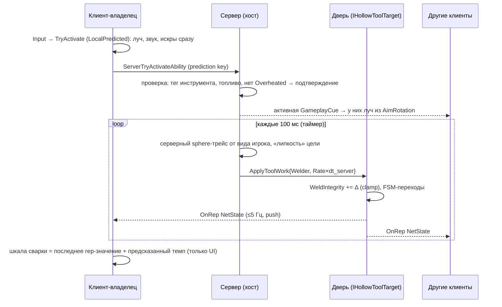

# Блок 3 — Физика и сетевая репликация (Deep Dive)

> Статус: **Proposed v0.1** · 2026-11-19
> Ключевые решения: [ADR-0002](../ADR/ADR-0002-replicate-state-not-simulation.md) (state, а не симуляция) и [ADR-0004](../ADR/ADR-0004-runtime-navmesh-door-links.md) (навмеш)

---

## 3.0 Доктрина сетевой физики (8 правил)

1. **Реплицируем состояние, а не симуляцию.** По сети идут enum'ы, квантованные скаляры, счётчики переходов и серверные метки времени. Трансформы осколков и искр не передаём никогда.
2. **Геометрия, влияющая на геймплей, задаётся заранее.** Швы резки, зоны пролома и «сломанные рамы» делаются вручную, поэтому на всех машинах совпадают по построению.
3. **Симуляция — это косметика, и она локальна.** Осколки, искры, сколы и сорванная створка на каждом клиенте свои. Они **никогда** не сталкиваются с Pawn и ИИ и не влияют на навмеш.
4. **Любое состояние должно переживать late-join и смену relevancy.** `OnRep` умеет сразу прыгнуть в финальное состояние без проигрывания перехода. Для этого есть `TransitionSerial` и возраст события по серверному времени.
5. **Время передаём, а не позу.** Створку двери, таймеры и обратный отсчёт клиент считает сам из `GameState->GetServerWorldTimeSeconds()` и стартовой метки.
6. **Всё, что меняет скорость движения, живёт в saved moves CMC**, то есть предсказывается и сверяется вместе с движением. В реплицируемых свойствах этого быть не должно.
7. **Свободные физтела** (брошенное ядро, отлетевшая баррикада) реплицируются в режиме Physics Replication **Predictive Interpolation**. Когда тело заснуло, движение больше не реплицируем и уводим актёр в dormancy. Число одновременно бодрствующих реплицируемых тел жёстко ограничено.
8. **Гигиена на каждой сетевой фиче:** push model (`MARK_PROPERTY_DIRTY_FROM_NAME`), `DORM_DormantAll` в покое и `FlushNetDormancy()` вместе с `ForceNetUpdate()` на переходах, квантизация, `SetNetUpdateFrequency` по смыслу.

### Сетевой бюджет по фичам (ориентиры, проверяем в Networking Insights)

| Фича | Что реплицируется | Размер полезной нагрузки | Частота |
|---|---|---|---|
| Дверь | `FHollowDoorNetState` | ~10 B | на переходе; ≤5 Гц во время сварки или резки; в остальное время dormant |
| Шов резки | `uint32 CutMask` + `uint8 ActiveProgressQ` | 5 B | ≤5 Гц, пока режут |
| Переборка | `FHollowBreachNetState` | ~12 B | 1–3 раза за рейд |
| Переноска | `FHollowCarryNetState` | ~4 B + 2 NetGUID | на смене режима |
| Брошенное ядро или проп | RepMovement (Predictive Interpolation) | ~30–40 B | 10–20 Гц, только пока не уснуло |
| Осколки Chaos | **ничего** | 0 | — |
| Луч чужого инструмента | активный GameplayCue (тег) | ~4 B | старт и стоп |
| Громкость голоса | `uint8` | 1 B | ≤5 Гц, только выше порога |
| Резонанс отряда | `uint8` | 1 B | ≤2 Гц, на изменении |

Целевые цифры: **≤ 40 KB/s в среднем и ≤ 80 KB/s в пике на клиента** на входящем канале. Тогда исходящий канал хоста ≈ 3 × 40 KB/s ≈ 1 Мбит/с, что подходит для домашних каналов и Steam Datagram Relay. `MaxClientRate`/`MaxInternetClientRate` выставляем явно, на дефолты не полагаемся.

---

## 3.1 Почему так: короткий разбор альтернатив

| Вариант | Вердикт |
|---|---|
| Встроенная репликация Geometry Collection (`bEnableReplication`) | ❌ Гоняет состояния кластеров и активных частей, это дорого и плохо работает с late-join. Мы её выключаем |
| Детерминированная Chaos-симуляция на всех машинах | ❌ Chaos не детерминирован между машинами: разный dt, порядок потоков, float. Дыра в стене разойдётся |
| Network Physics с ресимуляцией | ❌ Удваивает CPU-нагрузку хоста, сложно отлаживать, API ещё меняется |
| **Состояние + заранее заданная геометрия + косметическая симуляция** | ✅ Детерминированный **результат** (форма пролома, проходимость) при недетерминированных **осколках** |

---

## 3.2 Плазменный резак и сварка: конвейер инструментов

### Модель
- `UHollowGA_ContinuousTool` (база): `NetExecutionPolicy = LocalPredicted`, `InstancingPolicy = InstancedPerActor`, активация `WhileInputActive`.
- **Клиент (предсказание, только косметика):** луч, звук и искры стартуют сразу через predicted GameplayCue `GameplayCue.Hollow.Tool.Beam`. Точку попадания для своих искр клиент считает локальным трейсом.
- **Сервер (авторитет):** таймер с частотой `ToolDef->SampleRateHz` (10 Гц) → **серверный трейс** от вида игрока (`ControlRotation` приходит в ServerMove) → поиск `IHollowToolTarget` → `ApplyToolWork`.
  - **Дополнительного RPC нет**: сервер уже знает, куда смотрит игрок.
  - **Допуски:** sphere-трейс радиусом `HitToleranceRadius` (8–12 см) и «липкость цели»: текущая цель удерживается, пока угол отклонения ≤ 15° и прошло не больше 0.3 с без попадания. Без этого сварка дёргалась бы на краю двери при 100+ мс пинга.
  - **Прогресс зависит от времени сервера**, а не от заявок клиента: `Delta = Rate × dt_server × модификаторы сборки`. Ускорить резку спидхаком нельзя.
- **Чужие клиенты** видят активную кьюшку и сами трейсят из `GetBaseAimRotation()` simulated proxy. Точку попадания реплицировать не нужно.
- **Топливо и нагрев:** на активации навешивается бесконечный периодический `GE_Tool_FuelDrain` (Period 0.25 с, величина через SetByCaller `Hollow.Data.FuelCost`), на `EndAbility` он снимается. `ToolHeat` растёт с каждым сэмплом. При `ToolHeat ≥ MaxToolHeat` срабатывает `PostGameplayEffectExecute` и вешает `GE_Tool_Overheat`, который даёт тег `Hollow.State.Tool.Overheated` и блокирует активацию. Способность сама завершается по делегату изменения `ToolFuel` ≤ 0.
- *Реализация S2-03:* все числа в `UHollowToolDefinition` (`DA_Tool_Welder`, `DA_Tool_PlasmaCutter`, тип `HollowTool`, модуль GAS). Перегрев проверяет **способность** сразу после сэмпла нагрева (`GE_Tool_Overheat` с нативной базой `UHollowToolOverheatEffect`, выдающей тег), а не `PostGameplayEffectExecute`: способность — единственный источник нагрева, и набору атрибутов не нужно знать классы GE. Остывание — пассивный периодический `GE_Tool_Cooling` из AbilitySet. Ввод: `UHollowAbilitySystemComponent::AbilityInputTagPressed/Released` по тегу `Hollow.Input.*` (Cutter — ЛКМ/RT, Welder — ПКМ/LT). Проверено двумя процессами с `-PktLag=150`: 52 сэмпла за 5,1 с, максимальный разрыв 0,100 с.
- **Шум:** каждые `NoiseEveryNSamples` сервер вызывает `ReportNoise({Hollow.Noise.Tool.Welder, Location, Instigator})`. Громкость и радиус задаются в `UHollowNoiseConfig` (§3.8).



### Швы резки (`UHollowCutSeamComponent`): замки, люки, панели 🔶
Свободную резку меша мы **отвергаем**: это runtime boolean-операции, они не реплицируются и дорого стоят. Вместо этого используем **заранее нарисованные швы**, по той же логике, что cut points в Hardspace: Shipbreaker.
- В редакторе шов — это сплайн из N ≤ 32 сегментов, у каждого сегмента своя «прочность».
- Сервер берёт точку попадания в локальном пространстве, находит ближайший сегмент в пределах допуска и наращивает его прогресс. Состояние: `uint32 CutMask` (готовые сегменты) и `uint8 ActiveSegmentProgressQ`.
- Визуал: Custom Primitive Data (`SetCustomPrimitiveDataFloat`) задаёт маску сегментов, материал рисует раскалённый шов. Ни render target, ни Tick не нужны.
- Когда маска заполнена, срабатывает `OnSeamCompleted`. Дальше по типу шва: замок снят (флаг двери `Locked` сброшен), панель отпала (запускается тот же путь пролома, что у переборки, §3.4) или люк открыт.

---

## 3.3 Двери и сварка: state machine

### Данные (`UHollowDoorDefinition : UPrimaryDataAsset`)
`MaxWeldPoints`, `SealThreshold` (норм. 0.15), `WeldRateScale`, `CutRateScale`, `WeldAbsorbFactor` (какая доля структурного урона уходит в шов), `StructureHP`, `DeformStageThresholds` (TArray<float>), кривая убывающей отдачи для нескольких сварщиков, классы NavArea, звуки и VFX (soft), `OpenDuration` и `OpenCurve`.

### Реплицируемое состояние

```cpp
UENUM()
enum class EHollowDoorState : uint8 { Open, Opening, Closing, Closed, Welded, Breached };

UENUM(meta = (Bitflags, UseEnumValuesAsMaskValuesInEditor = "true"))
enum class EHollowDoorFlags : uint8 { None = 0, Powered = 1 << 0, Locked = 1 << 1, Barricaded = 1 << 2 };

USTRUCT()
struct FHollowDoorNetState
{
	GENERATED_BODY()

	UPROPERTY() EHollowDoorState State = EHollowDoorState::Closed;
	UPROPERTY() uint8 Flags = 0;              // EHollowDoorFlags
	UPROPERTY() uint8 WeldQ = 0;              // WeldIntegrity  [0..1] × 255
	UPROPERTY() uint8 StructureQ = 255;       // StructureHP    [0..1] × 255 → DeformStage вычисляется на клиенте по порогам из DA
	UPROPERTY() uint8 TransitionSerial = 0;   // ++ на каждом переходе: one-shot FX ровно один раз, даже если промежуточные состояния пропущены
	UPROPERTY() float StateServerTime = 0.f;  // начало текущего перехода (створка, FX), в серверном времени
};
// UHollowDoorStateComponent: UPROPERTY(ReplicatedUsing = OnRep_NetState) FHollowDoorNetState NetState;  push-based
```

### Таблица переходов (выполняются только на сервере)

| # | Из | Событие | Условие | В | Побочные эффекты |
|---|---|---|---|---|---|
| 1 | Closed | Interact(Open) | нет `Locked` | Opening → Open | nav: Doorway · шум Door |
| 2 | Open | Interact(Close) | проём свободен (overlap) | Closing → Closed | nav: DoorClosed |
| 3 | Closed | ToolWork(Weld) | Weld ≥ SealThreshold | **Welded** | nav: DoorWelded · `Hollow.Event.Door.Welded` |
| 4 | Welded | ToolWork(Weld) | — | Welded (Weld↑, clamp 1) | nav-cost bucket может смениться |
| 5 | Welded | ToolWork(Cut) | Weld − Δ > 0 | Welded (Weld↓) | — |
| 6 | Welded | ToolWork(Cut) | Weld ≤ 0 | Closed | nav: DoorClosed |
| 7 | Welded / Closed | StructuralDamage | урон сначала идёт в Weld × `WeldAbsorbFactor`, остаток — в Structure | то же (Deform↑) | шум Impact.Heavy |
| 8 | любое, кроме Breached | StructuralDamage | Structure ≤ 0 | **Breached** (терминальное) | nav: Doorway · косметическая створка · шум Structural.Breach |
| 9 | Closed + Locked | шов замка готов | — | Closed, `Locked` снят | — |

Математика (`HollowDoorMath::ApplyWeld/ApplyCut/ApplyStructural`) — чистые функции с clamp'ом, покрыты тестами (CLAUDE.md §7.2).

### Реализация S2-04
- `HollowPhysics/Doors`: `FHollowDoorNetState` со своим `NetSerialize` (состояние и флаги в одном байте, всего 8 байт, атомарно), `UHollowDoorDefinition` (`DA_Door_Standard`), чистые `HollowDoorRules` (вся таблица в `Apply`, `Accepts` = пробный прогон, `LeafAlpha`, `IsFreshTransition`), `UHollowDoorStateComponent`, `AHollowDoor` (`BP_Door`, правило биома Door → `BP_Door`).
- Реализованы строки 1–6 таблицы. Структурный урон и `Breached` (7–8) — с `IHollowStructural` в S3, замок-шов (9) — S2-07, убывающая отдача нескольких сварщиков — кооп-полировка S3. `StructureQ` уже в формате (всегда 255).
- Частичный шов ниже `SealThreshold`: дверь остаётся Closed и открывается, открытие сбрасывает шов; резак его тоже снимает. Во время Opening/Closing взаимодействие игнорируется.
- Створка: `InterpEaseInOut` с экспонентой из DA вместо `OpenCurve` (то же поведение, проще данные и тесты); по таймеру только во время перехода, на NavMesh не влияет (nav — S2-05).
- Занятость проёма — явный запрос пересечения формы проёма с pawn'ами в момент решения, а не учёт overlap-событий.
- Проверено двумя процессами (клиент с `-PktLag=150`): все 40 изменений шва (0,2 с троттлинг, финал 255 и 0) дошли до клиента по порядку, все 4 перехода — `fresh`.

### Детали сети
- Все двери спавнит **сервер** при сборке сектора (§2.6). Сразу после первой репликации они уходят в `DORM_DormantAll`.
- Переход выглядит так: `FlushNetDormancy()` → изменение → `MARK_PROPERTY_DIRTY_FROM_NAME` → `ForceNetUpdate()`.
- Пока идёт сварка, сервер помечает `WeldQ` грязным, только если квант изменился и с прошлой отправки прошло ≥ 200 мс. Финальное значение досылается при остановке.
- **Клиентский `OnRep_NetState(const FHollowDoorNetState& Old)`:** если `TransitionSerial` изменился и `ServerNow − StateServerTime < 1 с`, проигрываем переход и FX. Иначе (late-join, вернулась relevancy) сразу ставим финальное состояние.
- **Створка** вычисляется как `OpenCurve((ServerNow − StateServerTime) / OpenDuration)` на каждой машине. Трансформ не реплицируется.
- **Коллизия створки** блокирует Pawn только в `Closed`/`Welded`. На `Opening` блок снимается после 30% хода. `Closing` не начнётся, пока проём занят, чтобы никого не придавить и не вызвать коррекцию CMC.
- **Пролом двери Пилигримом** (§3.7): створку срывает **косметический** локальный физ-актёр на каждом клиенте. Он сталкивается только с WorldStatic, а на сервере у сорванной створки коллизии нет.
- **Несколько сварщиков на одной двери:** сервер суммирует вклад с убывающей отдачей по кривой из DA.
- **Баррикада у двери** (§3.6) повышает эффективную прочность, пока стоит флаг `Barricaded`.

---

## 3.4 Пролом Chaos-переборок

### Авторинг (Fracture Editor + Dataflow)
1. Меш переборки фрактурится в иерархию. Кластеры уровня L1 — это **зоны пролома** (дизайнер выбирает 1–3 на вариант). Рама L0 заякорена (anchor field или Set Anchored).
2. Для GC включён Nanite. `MaxClusterLevel` ≤ 2, листья мельче для крупного плана не нужны.
3. Под каждую зону готовится **«сломанная рама»**: статический меш, который даёт **геймплейную** коллизию после пролома. На всех машинах она одинаковая.
4. Для 1–3 «геройских» проломов на сектор (сюжетные моменты вроде «Пилигрим проламывает переборку») симуляция записывается в **Chaos Cache** (`AChaosCacheManager`, Record). В рантайме кэш проигрывается одинаково у всех и дешевле живой симуляции. Память на кэш меряем отдельно.

### Состав актёра `AHollowBreachableBulkhead`
- `IntactMesh` (статичный Nanite-меш, дешёвый, виден до пролома) и `BrokenFrameMesh` (скрыт до пролома, даёт геймплейную коллизию).
- `UGeometryCollectionComponent`, **создаётся лениво**: GC-ассет подгружается async (soft ref), когда игроки входят в соседнюю комнату. Компонент собственной репликации **не имеет** (`SetIsReplicated(false)`).
- `UHollowStructuralIntegrityComponent`: HP по зонам из `UHollowBreachableDefinition`, принимает `IHollowStructural`.
- `UNavLinkCustomComponent` через проём (выключен до пролома) и nav-blocker box (§3.7).

### Реплицируемое состояние
```cpp
USTRUCT()
struct FHollowBreachNetState
{
	GENERATED_BODY()
	UPROPERTY() EHollowBreachState State = EHollowBreachState::Intact;   // Intact | Weakened | Breached
	UPROPERTY() uint8 ZoneMask = 0;                                      // какие зоны пробиты
	UPROPERTY() uint8 DamageStageQ = 0;                                  // трещины и вмятины до пролома (декали, материал)
	UPROPERTY() FVector_NetQuantizeNormal ImpactDir;                     // направление разлёта (косметика)
	UPROPERTY() float BreachServerTime = 0.f;
	UPROPERTY() uint8 TransitionSerial = 0;
};
```

### Поток
- **Сервер:** урон (молот, взрыв, Пилигрим) → HP зоны ≤ 0 → бит в `ZoneMask`, `State = Breached`, `BreachServerTime` → `ForceNetUpdate`. Затем включается NavLink и снимается nav-blocker (§3.7), репортится шум `Hollow.Noise.Structural.Breach` (огромная громкость), Director получает уведомление.
- **Презентация** (на каждом клиенте и у хоста, решает `UHollowDestructionBudgetSubsystem`):

| Условие | Режим |
|---|---|
| `Age < 1.5 с`, есть слот в бюджете, дистанция < `MaxSimDistance`, объект недавно рендерился | **Full:** `IntactMesh` → GC; `CrumbleCluster`/`ApplyExternalStrain` по кластерам зон с импульсом из `ImpactDir`; для геройских проломов — проигрывание Chaos Cache |
| иначе (late-join, далеко, не видно, бюджет исчерпан) | **Snap:** сразу `BrokenFrameMesh` и статичный «щебень»-меш, без симуляции |

- **Осколки:** отдельный object channel `HollowDebris`. Блокирует WorldStatic и WorldDynamic, **игнорирует** Pawn, врагов, Visibility и трейсы инструментов. `bCanEverAffectNavigation = false`. Для removal используем `bAllowRemovalOnSleep` и `bAllowRemovalOnBreak` из GC-настроек удаления, а жёсткий потолок жизни задаёт бюджет-подсистема: досрочное «усыхание» самых старых.

### Бюджет разрушений (`UHollowDestructionBudgetConfig`, зависит от пресета Scalability)

| Пресет | Одновременных live-проломов | Активных rigid bodies | Макс. жизнь осколка | `MaxSimDistance` |
|---|---|---|---|---|
| Low / Steam Deck | 1 | 150 | 4 с | 15 м |
| Medium | 2 | 250 | 6 с | 25 м |
| High (RTX 3060) | 3 | 400 | 8 с | 35 м |
| Epic | 4 | 600 | 10 с | 50 м |

Пороги сна задаются в Physical Material (`SleepLinearVelocityThreshold`, `SleepAngularVelocityThreshold`, `SleepCounterThreshold`) и тюнятся в данных. Профилируем в **Chaos Visual Debugger**.

### Реализация S3-01 ([ADR-0014](../ADR/ADR-0014-breachable-bulkheads.md))
- **Геометрия.** Вместо `IntactMesh`/`BrokenFrameMesh` сделаны рамка `Frame` (притолока, блокирует всегда) и **панель на каждую зону** (`UHollowBreachableDefinition::Zones`: бокс, `MaxHealth`, `bRequiredForPassage`, GC зоны). Панели создаются из DA одинаково на всех машинах; сломанная зона скрывает панель и снимает её коллизию. Проход открыт, когда сломаны все обязательные зоны.
  - `DA_Bulkhead_Plate`: одна зона 300 × 320, 400 HP;
  - `DA_Bulkhead_Twin`: две половины по 200 HP. Первая сломанная половина даёт дыру, состояние остаётся `Weakened`.
- **Состояние** `FHollowBreachNetState`, 9 байт (`NetSerialize`):
  - состояние и маска зон в одном байте, `DamageStageQ`, yaw и pitch удара по байту, `BreachServerTime`, `TransitionSerial`;
  - хранится в `UHollowStructuralIntegrityComponent`: push, dormancy, `FlushNetDormancy` + `ForceNetUpdate`;
  - правила чистые (`HollowBreachRules`): удар попадает в ближайшую целую зону, один удар ломает не больше одной зоны, `Breached` терминален.
  - урон приходит через `IHollowStructural` (Core); в S3-01 его наносит только `Hollow.Dev.Breach`, Пилигрим подключится в S3-04.
- **Презентация** решается на каждой машине: `HollowBreachPolicy::Choose` (возраст < `FreshWindowSeconds` 1,5 с, камера ближе `MaxSimDistance`, `WasRecentlyRendered`, слот, тела) → `UHollowDestructionBudgetSubsystem`.
  - **Full:** GC зоны (`SetIsReplicated(false)`, `bEnableReplication = false`, профиль `HollowDebris`, начальная скорость `DebrisSpeed` вдоль удара, `PM_HollowDebris`). Через `MaxDebrisLifetime` GC удаляется, остаётся щебень.
  - **Snap:** сразу щебень без коллизии.
  - Таблица бюджетов `UHollowDestructionBudgetConfig` по `sg.EffectsQuality` (DefaultGame.ini). GC грузятся async в `BeginPlay`, только где `FApp::CanEverRender()`.
- **Осколки.** Object channel `HollowDebris` (`ECC_GameTraceChannel2`, ответ по умолчанию Block). Профиль: `PhysicsOnly`, Ignore для Pawn, PhysicsBody, Vehicle, Destructible, Visibility, Camera, Interaction.
- **Greybox GC.** `create_bulkhead_assets.py` → `UHollowGeometryCollectionAuthoring::CreateFracturedBox`:
  - Voronoi `FFractureEngineFracturing::VoronoiFracture` с фиксированным seed: 24 куска на Plate, 14 на половину;
  - кластеризация выключена, удаление по сну;
  - ⚠️ PlanarCut ремеширует поверхности разреза с шагом точек шума даже при нулевой амплитуде. При шаге 0 GC весил 45 МБ, поэтому шаг равен размеру бокса: 190 КБ.
- **Сборка сектора.** Bulkhead-соединения спавнят `BP_Bulkhead_Plate` или `BP_Bulkhead_Twin`. Выбор идёт по `FHollowConnectionActorRule::Variants` и `HollowRandom::DeriveSeed(Seed, ConnectionIndex)`.
- **Проверка в игре.**
  - Seed 7, один процесс с `-RenderOffScreen`: пролом перед игроком даёт Full (14 тел), осколки летят в pawn, его позиция не меняется. Пролом вне вида даёт Snap. Через 10 с осколков нет, бюджет освобождён.
  - Два процесса с задержкой 150 мс: обе машины показывают Full, после проломов у клиента ноль коррекций CMC.
  - Вход в идущий рейд закрыт правилами сессии (S1-03). Поэтому «поздняя» машина — это первичная репликация уже сломанного актёра (relevancy, медленная загрузка). Этот путь покрывает `Hollow.Physics.Breach.LateJoin`.

---

## 3.5 Переноска тяжёлых «Эфирных ядер»: соло, вдвоём, дрон, лебёдка

### Модель «виртуальные носилки» 🔶
Пока ядро несут, оно **не симулируется физически**. Его трансформ — **чистая функция от положения носильщиков**. Каждая машина вычисляет её сама, поэтому во время переноски трансформ ядра **не реплицируется вообще**.

```cpp
UENUM() enum class EHollowCarryMode : uint8 { None, Solo, Coop, Drone, Winched, Dragged };

USTRUCT()
struct FHollowCarryNetState
{
	GENERATED_BODY()
	UPROPERTY() EHollowCarryMode Mode = EHollowCarryMode::None;
	UPROPERTY() TObjectPtr<APawn> Primary = nullptr;
	UPROPERTY() TObjectPtr<APawn> Secondary = nullptr;
	UPROPERTY() uint8 TransitionSerial = 0;
};
// UHollowCarryableComponent на AHollowAetherCore; данные — UHollowCarryableDefinition:
// Weight, SoloSpeedScale (0.45), CoopSpeedScale (0.75), GripSpan, Slack, BreakDistance, LiftWindow, GE стамины и Резонанса
```

### Соло
1. `UHollowGA_CarryHeavy` (LocalPredicted). Клиент сразу проигрывает анимацию хвата и **выставляет бит переноски в saved move** (`FLAG_Custom_0/1`: 2 бита режима).
2. Сервер проверяет дистанцию (+допуск), что ядро свободно, что игрок ничего не несёт, теги. Затем выставляет `CarryState.Mode = Solo` и навешивает `GE_Carry_Solo`. GE даёт тег `Hollow.State.CarryingHeavy.Solo` (блокирует Sprint и Jump через `ActivationBlockedTags`), дренаж стамины и периодический прирост Резонанса.
3. **Скорость — это не атрибут GAS, а saved move.** Правило сервера: `EffectiveSlowdown = max(Claimed, ServerState)`, причём серверное состояние вступает в силу с грейсом 250 мс. *Заявить, что ты медленнее, — не чит*, поэтому сервер всегда принимает такую заявку, а коррекции на подъёме и сбросе пропадают.
4. Визуал: каждая машина **локально** крепит меш ядра к нужному компоненту. У владельца это FP-руки, у остальных — сокет TP-тела. Серверный корень ядра следует за капсулой (оверлапы зоны эвакуации, перцепция ИИ).

### Вдвоём (Coop)
- **Подъём:** второй игрок берётся за свободный хват. Если оба нажали в окне `LiftWindow` (0.75 с), включается `Mode = Coop`. Если нет, ядро можно только волочь (`Dragged`, очень медленно).
- **Трансформ ядра:** `Pos = Mid(Grip(Primary), Grip(Secondary)) + HeightOffset`, `Rot = MakeFromX(Secondary − Primary)` со сглаживанием. Позиции берутся от капсул, а не от анимированных сокетов, чтобы не было петли обратной связи. Руки доводятся до хватов через two-bone IK, это чистая косметика. Tick у `UHollowCarryableComponent` включается **только пока ядро несут**.
- **Тетер в CMC:** `d = |P_self − P_partner|` по горизонтали. Если `d > GripSpan + Slack`, гасим компоненту скорости «от партнёра» и добавляем ограниченное притяжение `k·(d − GripSpan − Slack)`.
- **Проблема:** на клиенте партнёр — это интерполированный proxy, который отстаёт примерно на RTT/2. На сервере партнёр авторитетный. Тетер посчитается по-разному, и посыплются коррекции.
- **Решение (PvE-компромисс)** 🔶: на время Coop у обоих носильщиков `bServerAcceptClientAuthoritativePosition = true` и `bIgnoreClientMovementErrorChecksAndCorrection = true`. Сервер раз в 0.25 с делает **санитарную проверку**: скорость ≤ `CoopMaxSpeed × 1.3`, разнос ≤ `GripSpan + BreakDistance`, нет проникновения в геометрию. При нарушении переноска разрывается, авторитет сервера возвращается. Результат: плавная переноска без резиновых откатов. В PvE-коопе это допустимо, а сама проверка защищает от физических глюков.
- **Скорости** (соло 0.45, кооп 0.75) и все пороги берутся из DA, тюнинг без пересборки.
- **Деградации:** носильщик умер, упал или отключился → `Coop → Solo` (у оставшегося соло-штраф). Отпустили оба → `None` (физический сброс).
- **Ограничение на уровни** (проверяется валидатором в `HollowEditor`): проёмы ≥ 300 uu, коридоры ≥ 300 uu, `GripSpan` ядра ≤ 120 uu. Ядро не блокирует мир, мир блокируют капсулы. Лёгкое визуальное касание стен допускаем.

### Сброс и физика
Сервер включает `SetSimulatePhysics(true)` и начальную скорость носильщиков, режим Physics Replication — Predictive Interpolation. На сне ядро получает финальный `ForceNetUpdate`, затем `SetReplicateMovement(false)` и dormancy.

### Реализация S3-02 ([ADR-0015](../ADR/ADR-0015-solo-carry-claim.md))
- **Классы** (`HollowPhysics/Carry`):
  - `AHollowAetherCore` — бокс-тело (корень: физика, коллизия, Predictive Interpolation) плюс визуальный меш и `IHollowInteractable`;
  - `UHollowCarryableComponent` — `FHollowCarryNetState` (push), сброс, сон → покой → dormancy, локальное крепление визуала;
  - `UHollowCarrierComponent` на pawn'е — предсказание подъёма, `Server_Drop`, `GE_Carry_Solo`, серверный режим для CMC;
  - `UHollowCarryableDefinition` (тип `HollowCarryable`);
  - `UHollowCarrySettings` (грейс 0.25 с, тайм-аут предсказания 1 с);
  - чистая `HollowCarryPolicy`.
- **Скорость — 2 бита в saved move** (`HollowMoveFlags::Carry*`, `FLAG_Custom_1/2`). Сервер берёт более медленный из режимов `max(claim, server)`; строгий серверный режим действует после грейса, мягкий — сразу.
  - Множители `SpeedScale`, `AccelerationScale`, `bAllowSprint`, `bAllowJump` по режимам лежат в `DA_MovementTuning_ExoFrame` (Solo 0.45 / 0.6, Coop 0.75 / 0.8, Dragged 0.25 / 0.5).
  - Спринт и прыжок запрещает тот же эффективный режим в CMC: это не способности GAS.
- **Подъём предсказан (E → заявка `Solo`), сброс нет:** заявка держится до прихода свободного состояния.
  - Вместо `UHollowGA_CarryHeavy` — обычное взаимодействие S1-06.
  - `GE_Carry_Solo` даёт тег `Hollow.State.CarryingHeavy.Solo`, блокирует `Hollow.Ability.Tool`, тратит 2 стамины/с и даёт +0.5 Резонанса/с.
  - `GE_Stamina_Recovery` на паузе, пока ядро в руках.
- **Крепление:**
  - корень ядра едет на капсуле в `GripOffset`, сервер прикрепляет его, `AttachmentReplication` повторяет;
  - визуал своего вида крепится к FP-камере, чужого — к сглаженному TP-мешу (смещение посчитано в `create_carry_assets.py` из меша `BP_ExoFrame`);
  - профиль коллизии `HollowCarried` — только перекрытия с WorldDynamic.
- **Сброс:**
  - сервер ищет место вокруг носильщика: перед ним, затем ±45 … 180°; тело должно помещаться, и между ним и центром капсулы не должно быть стены;
  - нет места — ядро остаётся в руках; уходящий носильщик оставляет ядро на своём месте;
  - клиенты сразу встают в серверную позу сброса;
  - сон → через 0.5 с тело кинематическое, `ReplicateMovement` выключен, `DORM_DormantAll`; клиенты встают в последнюю реплицированную позу; `MaxAwakeSeconds` 6 с.
- **Найдено по пути (S2-02):**
  - заглушки Sealed появлялись Static-компонентом, который уже зарегистрирован при deferred spawn; в мире с начатой игрой `SetStaticMesh` молча отказывал;
  - итог: все закрытые проёмы рейда были дырами из мира;
  - теперь заглушки Movable, а тест сборки идёт в «начатом» мире и прогоняет капсулу pawn'а через каждую заглушку.

### Дрон (соло-баланс) и лебёдка (Разведчик) — после VS
- **Drone:** тот же путь, что `Solo`; носильщик — AI-pawn дрона, хват на его сокете.
- **Winched:** ядро симулируется на сервере, сила направлена к якорю гарпуна, репликация через Predictive Interpolation. Это редкий режим, бюджет позволяет.
- **Zero-G:** у ядра выключена гравитация (`SetEnableGravity(false)` от гравитационного объёма), дальше та же Predictive Interpolation.

### Гравитационные зоны (Low-G)
`AHollowGravityVolume : APhysicsVolume` с собственным `GravityZ`. CMC и так берёт гравитацию из `GetPhysicsVolume()`. Объём статичен и одинаков у всех, поэтому предсказание работает бесплатно. Zero-G делается отдельным `MOVE_Custom` с инерцией и тягой, это после VS.

---

## 3.6 Физ-пропы и баррикады
- Пропы (ящики, шкафы) — реплицируемые актёры с Predictive Interpolation. Пока проп бодрствует, движение реплицируется; когда уснул — dormancy.
- **Агрегация в состояние двери:** у двери есть `BarricadeVolume`. Спящие пропы внутри него дают `BarricadeValue` (по массе, из данных) к эффективной прочности двери и ставят флаг `Barricaded`. Пилигрим сначала разносит баррикаду (сервер даёт импульсы, пропы просыпаются), потом дверь.
- **Фортификация Инженера:** проп, приваренный к двери, становится кинематическим. Трафик ноль, вклад в прочность больше.
- **Бюджет:** `MaxAwakeReplicatedProps` (по умолчанию 16). Сверх лимита пропы получают повышенный damping и засыпают раньше.
- **Навмеш пропы не трогают** (§3.7): у двери они учитываются через стоимость её nav-link, в остальных местах `bCanEverAffectNavigation = false`, а обход делает DetourCrowd.

---

## 3.7 Runtime NavMesh: двери, проломы, баррикады 🔶 [ADR-0004](../ADR/ADR-0004-runtime-navmesh-door-links.md)

### Базовые настройки
- `RecastNavMesh.RuntimeGeneration = Dynamic`. Базовый навмеш строится **после сборки сектора**, потому что геометрия процедурная и запечь её нельзя. Сборка асинхронная и прячется за сценой высадки. *S2-02:* вместо ожидания `OnNavigationGenerationFinishedDelegate` сервер после сборки делает один синхронный `UNavigationSystemV1::Build()` (за кадром загрузки; на Docks 10–25 мс) и проверяет путь Spawn → Extraction запросом `FindPathToLocationSynchronously` — так нет гонки «асинхронная пересборка ещё не началась».
- **Навмеш существует только на хосте** (`bAllowClientSideNavigation = false`), клиенты за него не платят.
- Агенты (каждый лишний — это ещё один навмеш, поэтому их два):

| Агент | Кто | Радиус | Высота |
|---|---|---|---|
| `Standard` | Шептуны, Эхо-Хищник | 45 | 220 |
| `Heavy` | Железный Пилигрим | 80 | 280 |

- Стартовые значения для тюнинга: `CellSize 15`, `TileSizeUU 1600`. Navigation Invokers не используем, сектор маленький и строится целиком.

### Двери: «Null-полоса + nav-link» (смена состояния за O(1), без пересборки тайлов)
- Проём **всегда** вырезан `UNavModifierComponent` с `UNavArea_Null`. Пройти можно только через двунаправленный `UNavLinkCustomComponent` двери.
- При смене состояния вызывается `SetEnabledArea(...)`/`SetEnabled(...)`. Меняется только area off-mesh-связи, **тайлы не пересобираются**.

| Состояние двери | Area связи | Standard (`NAV_Filter_Standard`) | Heavy (`NAV_Filter_Heavy`) |
|---|---|---|---|
| Open / Breached | `UHollowNavArea_Doorway` (cost 1) | ✅ | ✅ |
| Closed | `UHollowNavArea_DoorClosed` (cost 1.5, ИИ открывает) | ✅ | ✅ |
| Closed + Locked | `UHollowNavArea_DoorLocked` | ❌ (ищет вент или обход) | ✅ cost × 4, ломает |
| Welded (по бакетам прочности) | `UHollowNavArea_DoorWelded_{Low, High}` | ❌ | ✅ cost × 6 / × 10 |
| Barricaded | `UHollowNavArea_DoorBarricaded` | ❌ | ✅ cost × 8 |

- Фильтры — это `UNavigationQueryFilter` (`TravelCostOverride` и `bIsExcluded` по area). Цены живут в BP-наследниках `NAV_`, **тюнинг без пересборки C++**.
- Когда ИИ доходит до связи (`SetMoveReachedLink`), Пилигрим запускает задачу StateTree `BreachObstacle` → `GA_PilgrimBreach` (монтаж + MotionWarping к якорю двери) → на anim notify сервер вызывает `IHollowStructural::ApplyStructuralDamage`.
- **Инвалидация путей:** `UHollowNavUpdateSubsystem` рассылает `OnDoorNavChanged(Door, LinkId, Old, New)` и сам вызывает `Invalidate()` у путей, которые ИИ зарегистрировал через `WatchPath` и которые проходят через эту связь (`FNavPathPoint::CustomNavLinkId`). Путь перепрокладывается со своим запросом и фильтром (auto-update on invalidation).

### Переборки
- До пролома: стену блокирует **отдельный nav-blocker box**, а у GC и осколков всегда `bCanEverAffectNavigation = false`. NavLink через проём выключен.
- В момент пролома: (1) **сразу** включаем NavLink (O(1), ИИ мгновенно получает маршрут); (2) **отложенно и с низким приоритетом** снимаем blocker. Грязная область ограничена коробкой стены плюс радиус агента, это 1–2 тайла async. Вызываем `UNavigationSystemV1::UpdateComponentInNavOctree` или `UpdateActorInNavOctree`.
- *Реализация S3-01* ([ADR-0014](../ADR/ADR-0014-breachable-bulkheads.md)):
  - **Связь.** NavLink включён всегда, как у двери. Вместо «выключен» до пролома у него area `UHollowNavArea_BulkheadIntact`: в `NAV_Filter_Standard` исключена, в `NAV_Filter_Heavy` стоит ×12. Так Пилигрим (S3-04) может планировать пролом.
  - **Пролом.** Area сразу становится `UHollowNavArea_Doorway` (`SetEnabledArea` + `K2_ReplaceAreaInOctreeData` + `NotifyLinkChanged`).
  - **Блокер.** Через `BlockerRemovalDelay` (0,5 с) он уходит из октодерева: `SetCanEverAffectNavigation(false)` → `OnComponentUnregistered`, тайлы вокруг проёма пересобираются async.
  - **Генератор.** Переборка никогда не отрезает комнаты:
    - `AssignKinds` пропускает соединения-мосты, приёмка требует `ComponentsWithoutBulkheads == 1`;
    - со старым правилом в 684 из 1000 seed'ов Docks переборки отрезали в среднем 4,8 комнаты, на seed 7 — 12;
    - golden-хеш синтетического пула теперь `583C99A7`;
    - проверка пути Spawn → Extraction после сборки идёт фильтром Standard.

### Вентиляция: вне навмеша
Шахты — это **абстрактный граф** (`UHollowVentNetworkSubsystem`), узлы берутся из сокетов `VentNode` комнат, рёбра — из соединений `Vent` манифеста. Задача `TraverseVent` устроена так: анимация входа → скрытое перемещение по таймеру → движущийся источник звука вдоль шахты («он в вентиляции») → анимация выхода. Навмеш шахты не нужен, а ужаса в этом больше.

### Троттлинг
`UHollowNavUpdateSubsystem` собирает запросы за кадр, ограничивает тайловые пересборки до N/с и раздаёт приоритеты (проломы важнее прочего). Метрики выводятся в debug-оверлей.

### Реализация S2-05
- `HollowPhysics/Nav`: пустые нативные `UHollowNavArea_{Doorway, DoorClosed, DoorLocked, DoorWeldedLow, DoorWeldedHigh, DoorBarricaded}` (только цвет отладки), чистая `HollowDoorNav::AreaFor` (Open/Opening/Breached → Doorway; иначе Barricaded > Welded (порог `WeldedHighThreshold` = 0,5 включительно) > Locked > Closed; Closing считается Closed), `UHollowNavUpdateSubsystem` (`WatchPath`, `NotifyLinkChanged`, `PathUsesLink`), `UHollowNavSettings` (фильтры и имена агентов по умолчанию, DefaultGame.ini).
- Классы area — данные `UHollowDoorDefinition` (по умолчанию нативные), цены и запреты — только в `NAV_Filter_Standard/Heavy` (`/Game/Hollow/AI/Nav`, `create_nav_assets.py`). Вход и пролом Heavy-фильтр не различает: стоимость = длина связи × множитель.
- Вместо `UNavModifierComponent` полосу режет `NavCut` — `UBoxComponent` без коллизии: `bDynamicObstacle`, `AreaClassOverride = UNavArea_Null`, `HasCustomNavigableGeometry = EvenIfNotCollidable` (иначе компонент без блокировки Pawn не считается релевантным для навигации). Глубина ±2 × `WallThickness`, связь — ±(глубина + 100), то есть концы лежат на навмеше обоих агентов.
- Area меняет только сервер и только при её смене: `SetEnabledArea` (патч построенных тайлов, O(1)) **и** `K2_ReplaceAreaInOctreeData`. ⚠️ Ловушка движка: `SetEnabledArea` не трогает копию связи в октодереве, и любая последующая пересборка соседнего тайла (пролом, модификатор) вернула бы area на момент регистрации. Тест ловит это полной пересборкой со сваренной дверью.
- Агенты: `!SupportedAgents=ClearArray` + Standard (r45/h220) и Heavy (r80/h280), шаг 45. `Hollow.PCG.LevelMetrics` проверяет, что крупнейший агент совпадает с `LargestAgentRadius/Height`.
- Тесты: `Hollow.Physics.Nav.DoorAreas` (таблица) и `Hollow.Physics.Nav.DoorFilters` (тестовый мир без карты, реальный `BP_Door` и фильтры: Closed/Open — оба через дверь; Welded High/Low — Standard в обход, Heavy через дверь; наблюдаемый путь перепрокладывается в обход; тайлы и dirty-флаги не меняются; без обхода у Standard пути нет).
- Рейд (seed 7, один процесс, `Hollow.Nav.Path`): до сварки путь Spawn → Extraction у обоих агентов идёт через 6 дверей `DoorClosed`; после сварки двери шлюза у Standard пути нет, Heavy идёт через `DoorWeldedHigh`; пересборок навмеша после сборки сектора нет.
- Троттлинг тайловых пересборок, `SetMoveReachedLink` → `BreachObstacle` и подписка ИИ на `WatchPath` — вместе с ИИ (S3).

---

## 3.8 Шум → ИИ (включая голос)

```cpp
USTRUCT(BlueprintType)
struct FHollowNoiseEvent
{
	GENERATED_BODY()
	UPROPERTY() FGameplayTag NoiseTag;              // Hollow.Noise.*
	UPROPERTY() FVector Location = FVector::ZeroVector;
	UPROPERTY() TObjectPtr<AActor> Instigator = nullptr;
	UPROPERTY() float LoudnessScale = 1.f;          // множитель к значению из конфига (например, громкость голоса)
};
// UHollowNoiseSubsystem::ReportNoise (только сервер):
//   UHollowNoiseConfig: Tag → {BaseLoudness, MaxRange, ResonanceMultiplierCurve}
//   → UAISense_Hearing::ReportNoiseEvent(World, Location, Loudness, Instigator, MaxRange, NoiseTag.GetTagName())
//   → OnNoiseReported.Broadcast(Event)   // Heatmap, Director
```

**Голос** (backend-агностично) 🔶 [ADR-0006](../ADR/ADR-0006-online-stack-steam.md):
- Сам звук идёт через движковый VOIP поверх игрового соединения. `UVOIPTalker` на каждого игрока, `FVoiceSettings` с аттенюацией, окклюзией и цепочкой эффектов «шлем/рация».
- **Для ИИ** клиент сам меряет огибающую своего микрофона и шлёт `Server_ReportVoiceLoudness(uint8)` как unreliable RPC с частотой до 5 Гц, только если громкость выше порога или изменилась. Сервер делает clamp и вызывает `ReportNoise({Hollow.Noise.Voice, PawnLocation, Pawn, Loudness})`.
- Так голос перестаёт зависеть от выбранного voice-бэкенда: Steam, EOS или Vivox меняются без правки ИИ. Читерить, говоря «тише», в PvE бессмысленно.
- **Резонанс:** радиус слуха Эхо-Хищника умножается на `ResonanceMultiplierCurve(SquadResonance)`. Это кривая в данных.

---

## 3.9 Бюджеты производительности (RTX 3060, 1080p, High, TSR, 4 игрока)

**GPU, 16.6 мс:**

| Статья | Бюджет |
|---|---|
| Lumen GI + Reflections (Software) | 4.0–5.0 мс (Lumen Lite на Low и Deck) |
| Тени (VSM): ≤ 4 подвижных теневых источника в кадре; MegaLights — эксперимент в Sprint 4 | 2.0–2.5 мс |
| Nanite visbuffer + base pass | 1.5–2.0 мс |
| Прямое освещение | 1.0–1.5 мс |
| Volumetric Fog | 0.8–1.0 мс |
| Niagara и полупрозрачность | 0.8–1.0 мс |
| Post + TSR | 1.5–2.0 мс |
| UI и прочее | 0.5 мс |
| **Запас** | ≥ 1.5 мс |

**CPU Game Thread хоста** (он одновременно сервер и клиент), цель ≤ 11 мс:

| Статья | Бюджет |
|---|---|
| Геймплей (GAS, компоненты, таймеры) | 1.5 мс |
| ИИ (StateTree, перцепция, EQS; ≤ 20 агентов с Significance LOD) | 1.5 мс |
| Движение (CMC: 4 игрока + ИИ, у дальних шептунов NavWalking) | 1.5 мс |
| Физика (game-thread часть Chaos) | 1.5–2.0 мс |
| Анимация (Budget Allocator, URO) | 2.0 мс |
| Сеть (репликация для 3 клиентов) | 1.0–1.5 мс |

Инструменты: Unreal Insights (`-trace=cpu,gpu,frame,net,physics`), `stat unit` и `stat net`, Chaos Visual Debugger, Networking Insights. **Каждый спринт** снимаем на хосте трассу 4-игровой сессии (Блок 4).

---

## 3.10 Тесты Блока 3 (по CLAUDE.md §7)

| Тест | Тип | Что проверяет |
|---|---|---|
| `Hollow.Physics.Door.WeldClamp` | Simple | Weld ∈ [0,1], порог Seal, убывающая отдача, поглощение структурного урона |
| `Hollow.Physics.Door.Transitions` | Simple | вся таблица §3.3, включая запрещённые переходы |
| `Hollow.Physics.Door.NetStateRoundTrip` | Simple | `FHollowDoorNetState` → FBitWriter → FBitReader → `ApplyVisualState` даёт ту же презентацию; late-join приходит в Snap |
| `Hollow.Physics.Seam.Progress` | Simple | выбор сегмента по точке с допуском, заполнение маски |
| `Hollow.Physics.Breach.PresentationPolicy` | Simple | Full или Snap по возрасту, бюджету и дистанции; таблица бюджетов не убывает с качеством |
| `Hollow.Physics.Breach.{Rules, NetStateRoundTrip, Budget}` | Simple / мир | зоны, `Weakened`/`Breached`, 9 байт на проводе, направление удара; слоты, тела, истечение по таймеру (S3-01) |
| `Hollow.Physics.Breach.{DebrisCollision, Bulkhead, LateJoin}` | мир | профиль `HollowDebris` и sweep pawn'а сквозь осколки; настоящие `BP_Bulkhead_*`: панели, Snap, Full с GC, щебень; первичная репликация сломанной переборки → Snap (S3-01) |
| `Hollow.Physics.Nav.BulkheadBreach` | мир | Standard не проходит, Heavy ломится; после пролома сразу через связь; после снятия блокера навмеш сам проходит проём (S3-01) |
| `Hollow.PCG.Generator.BulkheadsAreDetours` | Simple | ни одна комната не достижима только через переборку (200 seed'ов; в `DocksPool` — на реальном ките) |
| `Hollow.Physics.Carry.SlowdownPolicy` | Simple | `max(claimed, server)` и грейс 250 мс: граница включительно, смягчение сразу, медленная заявка принимается, Coop/Solo/Dragged, отрицательный возраст (S3-02) |
| `Hollow.Physics.Movement.SavedMoveCarryBits` | мир | 2 бита заявки туда-обратно, без склейки при смене, сервер: грейс → порог, скорость, ускорение, нет прыжка и спринта, replay восстанавливает живую заявку (S3-02) |
| `Hollow.Game.Carry.{SoloCycle, Presentation, Prediction}` | мир | подъём через Interact, тег и блок инструментов, сброс со скоростью, сквозь стену и в углу, сон → dormancy, принудительный сон, уход носильщика; FP у своего, TP у чужого, первичная репликация несомого ядра; предсказанная заявка, тайм-аут, подтверждение (S3-02) |
| `Hollow.PCG.Sector.Assembly` | мир | *(S3-02)* сборка в «начатом» мире; капсула pawn'а не проходит ни через одну заглушку Sealed |
| `Hollow.Economy.Resolver.{ExtractionKeepsEverything, DeathKeepsOnlyInsured, SignalLost}` | Simple | исходы ADR-0016: лоадаут, страховка (нестрахуемое не застраховать), продажа ядер, кредиты не трогаются (S3-03) |
| `Hollow.Economy.Profile.Escrow` | Simple | маркер и снимок, чужой RaidId игнорируется, новый рейд закрывает висящий как Abandoned, SignalLost, SaveGame туда-обратно и «вылет» (S3-03) |
| `Hollow.Game.Raid.{Rules, ExtractionZone, Death}` | Simple / мир | таймер отлёта (старт, сброс, ноль), исходы при отлёте; зона видит игроков и свободные и несомые ядра; урон через GE → Dead, тег, ядро упало (S3-03) |
| `Hollow.Physics.Carry.Tether` | Simple | математика тетера и порог разрыва |
| `Hollow.Physics.Nav.DoorFilters` | Functional (тест-карта) | `FindPathSync` для фильтров Standard и Heavy по каждому состоянию двери |
| Ручной | PIE 2+ игрока, Network Emulation *Bad* | сварка, пролом, кооп-переноска без коррекций и рассинхрона (DoD CLAUDE.md) |
